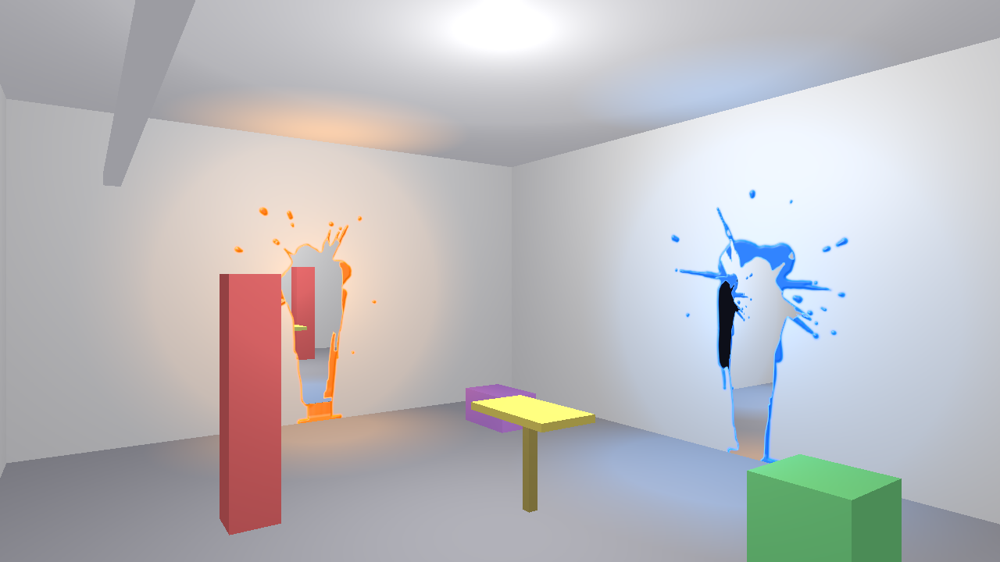
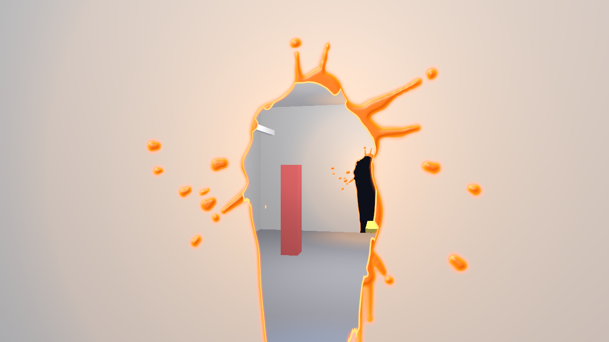

# Portaballs

A VR test room where you throw paint balls by hand. Orange from your left hand, blue from your right. The paint splats, drips down the wall and pools on the floor, and once there's an orange patch and a blue patch they link up as a portal you can look through, throw through, walk through or fall through. Any wall works, and so do the floor and the ceiling.



It's a proof of concept, not a game. There's one grey room with some boxes in it and a couple of debug boards on the walls. I wanted to know if throwing paint with your own arm and then stepping through it would feel good in a headset, and it does, so I'm putting it out there for anyone who wants to try it or pull it apart.



Yes, the idea comes from Portal. The crossing works like Portal's: a patch high on a wall drops you out of it, and falling into a floor portal throws you out of the other end at the speed you went in. Nothing in it is from Valve's games.

It runs on [s&box](https://sbox.game), Facepunch's engine on Source 2, built from [their public source](https://github.com/Facepunch/sbox-public). You don't need to own s&box or sign in to Steam to play it.

## Before you install

There's no download-and-play build. Facepunch's engine files can't be handed out without their licence and Valve's approval, so the installer gets them straight from Facepunch and builds the engine on your PC instead. That means:

- Windows 10 or 11, 64-bit, and about 20 GB free on C:
- 15 minutes to an hour for the first install, mostly the engine download (about 10 GB)
- SteamVR for the headset. Flat screen works without it.
- You agree to [Facepunch's terms](https://store.steampowered.com/eula/590830_eula_0) during the install, for their engine files.

I've only played it on a Steam Frame streaming from my PC (RTX 4070 Super). Other SteamVR headsets should work since it goes through SteamVR, but I haven't tried them. The aim help follows your eyes on a headset with eye tracking that SteamVR can see, which on mine is the Frame, and your head on anything else.

**Comfort:** you can fall through the floor, get flung out of a wall, and after a crossing the room swings back upright under you over a quarter of a second. Turning is smooth. If VR movement gets to you, go easy, and play in a clear space.

## Install

1. Download this repository: **Code > Download ZIP** at the top of this page, or `git clone` it.
2. Unzip it somewhere with a short path, like `C:\Portaballs-source`.
3. Double-click `Install Portaballs.cmd`. Nothing here is code signed, so Windows may warn you about a file from the internet: click **More info**, then **Run anyway**.
4. It checks for Git and the .NET 10 SDK and offers to get them if they're missing. Then it asks you to type YES for Facepunch's terms, downloads and builds the engine, and adds the game.

Everything goes in `C:\Portaballs`. When it's done you get **Portaballs VR** and **Portaballs flat screen** on your desktop, and an editor shortcut in the Start menu.

If it stops partway, for example because your connection dropped, run it again. It carries on from where it was. What it does is all in [tools/install.ps1](tools/install.ps1) if you want to read it first.

## Playing

**In the headset:** start SteamVR, then double-click **Portaballs VR**.

- Squeeze grip to get a ball, throw, and let go. Left hand throws orange, right hand throws blue.
- The ball goes where you threw it, pulled a little toward what you were looking at.
- Left stick walks, right stick turns.
- A new splat of a colour joins that colour's patch if it touches it, and replaces it if it lands somewhere else. One orange patch plus one blue patch makes a portal.
- Walk into an opening on a wall, or stand over one in the floor.

Some buttons switch test settings for the portal view: **B** cycles the view mode (the default is the best one), **left stick click** paints a pair of test portals for you, **right stick click** switches the portal picture between every frame and every other frame.

**Flat screen:** double-click **Portaballs flat screen**. WASD and the mouse to move, left click throws orange, right click throws blue. **6** paints a test pair.

## What's rough

- It's one test room. No menu, no sound, no goal.
- Your hand and the ball you're holding show through a portal, but a few millimetres right at the surface can show a thin gap if you look from the side.
- While a big splat is still dripping, the opening's centre can jump down a bit in the first second or two. It settles after that.
- Throws tend to land a little high. I'm not sure why yet.
- s&box is started with Steam turned off. It still made a couple of requests to Facepunch's servers in my tests (a rewards check that gets refused, and a workshop lookup). I haven't looked into everything the engine itself sends.

## Problems

**My antivirus flagged something.** Nothing here is code signed. The installer is a PowerShell script that downloads things and builds programs, and the tracking helper it builds (`C:\Portaballs\helper\PortaballsHelper.exe`) is a brand new unsigned program that reads SteamVR and listens on a local port, which some antivirus software doesn't like the look of. All of it is built on your PC from the source here, so you can read what it does. If you'd rather not allow it, the game still runs without the helper.

**The installer stops during Setup.bat.** Run it again. If it keeps stopping at the same place, open an issue with the log from `C:\Portaballs\logs`.

**The headset shows nothing, or the game opens on the monitor.** Make sure SteamVR is running first. The VR icon points the game at SteamVR even if your PC's default VR runtime is something else (Oculus, Virtual Desktop). `C:\Portaballs\logs\launch_vr.log` says what happened.

**A board in the room says HELPER NOT CONNECTED.** The tracking helper reads your hands and eyes from SteamVR 500 times a second, which makes throws more accurate. It listens on `127.0.0.1` port 8443 only, so it fails if something else is using that port. The game still works without it, from the engine's once-a-frame hand positions.

## Removing it

Delete `C:\Portaballs` and the shortcuts on your desktop and in the Start menu. The installer doesn't change anything else, apart from Git or the .NET SDK if you let it install them. Those stay, and you can remove them in **Settings > Apps** if you don't want them.

## How it's built

- `core/` is the engine-free maths: throwing, aim help, the paint (splats, drips, run-off, puddles), portal crossings, the player's body falling through floors. It has its own tests that run without the engine.
- `game/portaballs/` is the s&box project.
- `engine-patches/` are four small changes to s&box's C#, mostly so each eye gets its own picture through a portal. [engine-patches/README.md](engine-patches/README.md) explains each one.
- `helper/` is the tracking helper, a small program that talks to SteamVR through OpenVR.
- [docs/how-it-works.md](docs/how-it-works.md) has the numbers.

Run the tests with the .NET 10 SDK:

```powershell
dotnet test core\tests\Paint.Tests\Paint.Tests.csproj
dotnet test core\tests\Portals.Tests\Portals.Tests.csproj
dotnet test core\tests\Throwing.Tests\Throwing.Tests.csproj
dotnet test core\tests\Link.Tests\Link.Tests.csproj
dotnet test helper\tests\Helper.Tests\Helper.Tests.csproj
```

After changing the game, run `tools\install.ps1 -GameOnly` to copy it into `C:\Portaballs` again, or open it from the editor shortcut.

## Credits

Built with [Claude Code](https://claude.com/claude-code). I came up with the idea, tested it in the headset and told it what was wrong.

Runs on [s&box](https://github.com/Facepunch/sbox-public) by Facepunch. The helper uses Valve's [OpenVR](https://github.com/ValveSoftware/openvr).

## License

MIT, see [LICENSE](LICENSE). The changed engine files in `engine-patches/` stay under Facepunch's MIT licence. Other notices are in [THIRD_PARTY_NOTICES.md](THIRD_PARTY_NOTICES.md).

Not made by or connected with Valve or Facepunch.
